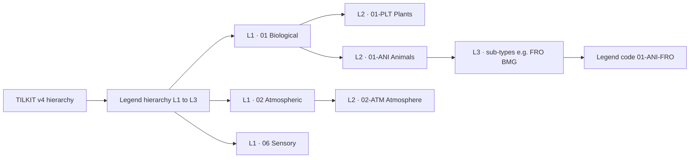

# TILKIT indicator hierarchy - reference compendium

**Version:** TILKIT Weather Indicator Log Master Template v4 (OND 2026)  
**Legend rows:** 157 standard sub-type codes on the *Indicator Code Legend* sheet.
**Canonical type lines:** 7 (`01-PLT`, `01-ANI`, `02-ATM`, `03-AST`, `04-HYD`, `05-RIT`, `06-SEN`).

---

## Table of contents

1. [Purpose and conceptual frame](#1-purpose-and-conceptual-frame)
2. [How codes are built](#2-how-codes-are-built)
3. [Top-level hierarchy (six categories)](#3-top-level-hierarchy-six-categories)
4. [Seven canonical type lines](#4-seven-canonical-type-lines)
   - [4.2 Hierarchy diagram (conceptual)](#42-hierarchy-diagram-conceptual)
   - [4.3 Setup mind map (program admin)](#43-setup-mind-map-program-admin)
5. [Workbook capture levels](#5-workbook-capture-levels)
6. [Complete code catalogue by category](#6-complete-code-catalogue-by-category)
6A. [Hierarchy levels vs workbook columns (all stages)](#6a-hierarchy-levels-vs-workbook-columns-all-stages)
7. [Indigenous knowledge context (literature)](#7-indigenous-knowledge-context-literature)
8. [Prior multipliers and weighting (summary)](#8-prior-multipliers-and-weighting-summary)
9. [Sources and further reading](#9-sources-and-further-reading)
10. [Appendix - alphabetical code index](#10-appendix--alphabetical-code-index)


---

## 1. Purpose and conceptual frame

TILKIT (Traditional Indigenous and Local Knowledge tool) systematises **consensus-based ethnographic weather indicators** for community climate monitoring and seasonal rainfall forecasting. The tool was developed and validated through participatory training across East Africa (Kenya, Tanzania, Uganda) and is designed to complement-not replace-national meteorological outlooks (e.g. Kenya Meteorological Service Authority) via **knowledge integration** and impact-based advisories.

Each **indicator** is a culturally situated environmental sign whose local meaning is negotiated in workshop and plenary: what rainfall outcome it signals (amount tercile, onset/cessation, distribution), **lead time** after observation, and community confidence (above / normal / below normal rainfall for the season).

This document describes the **classification hierarchy** that standardises how signs are catalogued before community members attach local names and behaviours:

| Analytical level | Example | Role |
|------------------|---------|------|
| Category `01`–`06` | `01` Biological | Broad domain of the phenomenon. |
| Type line | `01-ANI` | One of seven workbook families spanning categories. |
| Type segment (workbook B) | `ANI` | Plants vs animals within category 01, etc. |
| Sub-type | `FRO` | Phenomenological subclass (frog activity). |
| Legend code | `01-ANI-FRO` | Controlled vocabulary row on the legend sheet. |
| Unique Indicator ID | `01-ANI-FRO-001` | Stable instance ID for a registered sign (column AH). |
| Registered sign | Local name + behaviour (C, D) | Site-specific manifestation of the legend code. |

---

## 2. How codes are built

### 2.1 Syntax

```text
CC-TTT-SSS
│  │   └── Sub-type (3 letters) - phenomenological class
│  └────── Type segment (3 letters) - PLT, ANI, ATM, AST, HYD, RIT, SEN
└───────── Category (2 digits) - 01 … 06
```

The **type line** used in analysis and priors is `CC-TTT` (category + type segment), e.g. `03-AST`.

### 2.2 Relationship to Unique Indicator ID

Workshop participants register **specific signs** under a legend code. The master template assigns a running suffix:

```text
01-ANI-FRO-001   →   category 01, type ANI, sub-type FRO, instance 001
```

The suffix (`-001`) is **per sign**, not per season or site. Sites and seasons are separate dimensions on the Indicator Log row.

### 2.3 v4 taxonomy realignment (October 2026)

Version 4 realigned legacy category/type codes into **six categories** and **seven type lines**, with ~160 legend rows and literature-derived **prior multipliers** (0.55–1.35). Historical tallies must remain reproducible under the protocol version that generated them.

---

## 3. Top-level hierarchy (six categories)

These are the v4 **Category** codes (`01`–`06`) from `tilkit_indicator_taxonomy.json` and the master legend:

### Category `01` - Biological / ecological

- **Legend sub-type codes in this category:** 58
- **Type segments present:** ANI, PLT

### Category `02` - Atmospheric / physical / meteorological

- **Legend sub-type codes in this category:** 43
- **Type segments present:** ATM

### Category `03` - Astronomical / astrological / celestial

- **Legend sub-type codes in this category:** 22
- **Type segments present:** AST

### Category `04` - Hydrological

- **Legend sub-type codes in this category:** 17
- **Type segments present:** HYD

### Category `05` - Ritual / divinatory

- **Legend sub-type codes in this category:** 8
- **Type segments present:** RIT

### Category `06` - Sensory / human body

- **Legend sub-type codes in this category:** 9
- **Type segments present:** SEN

---

## 4. Seven canonical type lines

TILKIT v4 analysis and mind-map views use exactly **seven type lines** (one per category except `01`, which splits into plants and animals):

| Type line | Category | Short label |
|-----------|----------|-------------|
| `01-PLT` | `01` Biological / ecological | Plants |
| `01-ANI` | `01` Biological / ecological | Animals |
| `02-ATM` | `02` Atmospheric / physical / meteorological | Atmosphere |
| `03-AST` | `03` Astronomical / astrological / celestial | Sky (sun, moon, stars) |
| `04-HYD` | `04` Hydrological | Water |
| `05-RIT` | `05` Ritual / divinatory | Ritual |
| `06-SEN` | `06` Sensory / human body | Sensory / body |

**Note:** Category `01` is the only category with **two** type lines (`01-PLT` and `01-ANI`). All other categories map one type line each.

### 4.1 Code counts by type line

| Type line | Sub-type codes | Share of legend |
|-----------|----------------|-----------------|
| `01-PLT` | 20 | 12.7% |
| `01-ANI` | 38 | 24.2% |
| `02-ATM` | 43 | 27.4% |
| `03-AST` | 22 | 14.0% |
| `04-HYD` | 17 | 10.8% |
| `05-RIT` | 8 | 5.1% |
| `06-SEN` | 9 | 5.7% |

### 4.2 Hierarchy diagram (conceptual)

The **Indicator analysis mind map** on program **Setup** shows one branch only: the **legend hierarchy** (L1 → L2 → L3 → legend codes). Workbook capture stages (unique ID, sighting, reliability, column D, and so on) are not separate mind-map pillars; they stay in [section 6A](#6a-hierarchy-levels-vs-workbook-columns-all-stages) and in capture forms.



**Below the legend code** (not drawn on the mind map): unique Indicator ID (`AH`), registered sign (**C**), season behaviour (**D**), predictions and scoring columns - see sections 5 and 6A.

### 4.3 Setup mind map (program admin)

| Item | Detail |
|------|--------|
| **Where** | TILKIT program **Setup** (`/tools/{project}/tilkit/setup`), card *Indicator analysis mind map* |
| **Data** | `IndicatorCodeLegendGrouper::analysisMindmap()` built from `IndicatorLegendTree` (parsed legend code segments, same buckets as the dictionary) |
| **Root node** | `TILKIT v4 hierarchy → workbook A–D` |
| **Single pillar** | *Legend hierarchy (L1–L3)* - expandable drill-down only |
| **L1** | Six categories `01`–`06` (counts per category) |
| **L2** | Seven canonical type lines under the chosen category (e.g. `01-PLT`, `01-ANI`) |
| **L3** | Sub-type groupings under the type line (legend sub-type segment) |
| **Leaves** | Up to 20 sample legend codes per L3 group (full list in the dictionary); optional column D behaviour hints |

**Interaction**

- Click a node to reveal the **next level**; **siblings at the same level stay on the canvas** (categories, types, and sub-types are not collapsed when you expand one branch).
- Click the same L1/L2 node again to collapse that branch; click an L3 node again to hide its code sample leaves.
- Pan and scroll to zoom; **Full screen**, **Copy image** (clipboard), and **Download PNG**; styling follows light/dark mode.

**Aligned UI on Setup**

- **Site monthly indicator catalogue** uses the same L1 → L2 → L3 nested panels plus per-month code checkboxes (`IndicatorLegendTree`).
- **Legend reference** list on Setup uses the same tree for quick lookup.

Import legend data before the map fills: `php artisan tilkit:import-legend`. Regenerate code buckets after taxonomy or import changes: `php artisan tilkit:reconcile-indicator-codes` when DB category/type columns drift from code strings.

---

## 5. Workbook capture levels

The Community Data List and Indicator Log align capture fields to the same conceptual stack:

| Workbook | Field | Meaning |
|----------|-------|---------|
| **A** | Indicator category | Broad group `01`–`06` |
| **B** | Type & sub-type | e.g. type line `01-ANI` and sub-type `BMG` |
| **C** | Registered sign (local name) | Community name for this sign |
| **D** | Behaviour | What the sign looks, sounds, or feels like when active |
| **AH** | Unique Indicator ID | e.g. `01-ANI-FRO-001` |

### 5.1 Classification label vs column D behaviour

Do **not** put the legend sub-type description (e.g. "Flowering/blooming") directly into column **D**. That text classifies the *kind* of sign (workbook **B** / legend row). Column **D** is the **observable behaviour this season**, chosen from domain-consistent options-for example for `01-PLT-FLW`:

- Heavy blossoming / peak bloom
- Light or scattered flowering
- Flowers shedding / petals dropping

…plus an **intensity** (High / Medium / Low / Not observed). Stored form: `Behaviour text | Intensity: High`.

For `01-ANI-BMG`, behaviours include bird migration direction and flock movement-not plant flowering. The app catalogue `tk/config/tilkit_indicator_behaviour_catalog.json` (regenerate via `tilkit_docs/build_indicator_behaviour_catalog.py`) enforces this for all 157 legend codes.

Workshop flow (**A. For every sign / B. With every sighting / C. After the season / D. Data desk**) mirrors these levels.

**Tercile forecast (column U):** `3` = above normal, `2` = normal, `1` = below normal, `0` = no prediction yet.

---

## 6. Complete code catalogue by category

Full list extracted from the v4 master *Indicator Code Legend* sheet. Each row is one **legend code** (`CC-TTT-SSS`) with its descriptive label.

### 6.1 Category `01` - Biological / ecological

#### Type line `01-ANI` - Animals/ livestock

| Code | Sub-type | Description |
|------|----------|-------------|
| `01-ANI-AMP` | `AMP` | Amphibians |
| `01-ANI-ANT` | `ANT` | Ant/termite activity or colony movement |
| `01-ANI-AQU` | `AQU` | Aquatic animal behaviour/migration (fish, crabs, etc.) |
| `01-ANI-ASR` | `ASR` | Movement toward shelter, water or settlements |
| `01-ANI-BAD` | `BAD` | Appearance/disappearance of particular birds |
| `01-ANI-BCL` | `BCL` | Calling, singing or unusual bird sounds |
| `01-ANI-BEE` | `BEE` | Bee movement/abundance |
| `01-ANI-BFD` | `BFD` | Changes in feeding or foraging |
| `01-ANI-BFL` | `BFL` | Unusual flock size, direction or gathering |
| `01-ANI-BMG` | `BMG` | Seasonal migration or movement |
| `01-ANI-BNR` | `BNR` | Nesting, roosting or breeding-site behaviour |
| `01-ANI-BRD` | `BRD` | Birds |
| `01-ANI-BUT` | `BUT` | Butterfly appearance/migration/abundance |
| `01-ANI-CON` | `CON` | Animal body condition/physical signs |
| `01-ANI-EMG` | `EMG` | Emergence from burrows/ground |
| `01-ANI-FED` | `FED` | Feeding/grazing behaviour or unusual appetite |
| `01-ANI-FRG` | `FRG` | Frog calls, emergence or activity |
| `01-ANI-FRO` | `FRO` | Frog croaking/activity |
| `01-ANI-FSH` | `FSH` | Fish |
| `01-ANI-INS` | `INS` | Insects |
| `01-ANI-LBC` | `LBC` | Body condition/appearance linked to seasonal conditions |
| `01-ANI-LIV` | `LIV` | Cattle, goats, sheep or other livestock behaviour |
| `01-ANI-LOC` | `LOC` | Movement toward/away from water, shelter or settlements |
| `01-ANI-MAM` | `MAM` | Mammals |
| `01-ANI-MAT` | `MAT` | Mating/breeding behaviour or frequency |
| `01-ANI-MIG` | `MIG` | Migration/arrival/disappearance/movement |
| `01-ANI-MOL` | `MOL` | Molluscs |
| `01-ANI-MOS` | `MOS` | Mosquito abundance/activity |
| `01-ANI-NST` | `NST` | Nesting/roosting/breeding behaviour |
| `01-ANI-OTH` | `OTH` | Any Other (specify) |
| `01-ANI-REP` | `REP` | Reptiles |
| `01-ANI-SNA` | `SNA` | Snail appearance/abundance |
| `01-ANI-SNP` | `SNP` | Snake/reptile movement or appearance |
| `01-ANI-SPD` | `SPD` | Spiders |
| `01-ANI-SWM` | `SWM` | Swarming/abundance of insects |
| `01-ANI-TER` | `TER` | Termite emergence, flying or colony activity |
| `01-ANI-VOC` | `VOC` | Animal/bird calls, singing or unusual sounds |
| `01-ANI-WLM` | `WLM` | Movement of wild animals toward/away from areas |

#### Type line `01-PLT` - Plants/ crops

| Code | Sub-type | Description |
|------|----------|-------------|
| `01-PLT-CON` | `CON` | Cones / seed structures (e.g. pinecones) |
| `01-PLT-CRP` | `CRP` | Crop condition/ crop stress (wilting, yellowing, early tasselling) |
| `01-PLT-FLW` | `FLW` | Flowering/blooming |
| `01-PLT-FRU` | `FRU` | Fruit formation/ripening/abundance |
| `01-PLT-FUN` | `FUN` | Fungi / mushrooms |
| `01-PLT-GER` | `GER` | Germination/sprouting/seed emergence |
| `01-PLT-GRS` | `GRS` | Grass |
| `01-PLT-HRB` | `HRB` | Herb |
| `01-PLT-LAF` | `LAF` | Leaf emergence/flush/new leaves |
| `01-PLT-LEF` | `LEF` | New leaves/green flush |
| `01-PLT-LFS` | `LFS` | Leaf shedding/wilting/drying |
| `01-PLT-LSH` | `LSH` | Leaf fall, wilting or drying |
| `01-PLT-OTH` | `OTH` | Any Other (specify, e.g., fire) |
| `01-PLT-PST` | `PST` | Pasture/ browse/ fodder condition (greenness, regrowth, drying) - vegetation condition |
| `01-PLT-SAP` | `SAP` | Sap/resin/plant exudate changes |
| `01-PLT-SHR` | `SHR` | Shrub |
| `01-PLT-TFL` | `TFL` | Flowering of trees before/around rains |
| `01-PLT-TRE` | `TRE` | Tree |
| `01-PLT-VEG` | `VEG` | General greenness, vigour or deterioration |
| `01-PLT-VIN` | `VIN` | Vine (Climber) |

### 6.2 Category `02` - Atmospheric / physical / meteorological

#### Type line `02-ATM` - Wind, cloud, air, rain, temperature, humidity, thunder, lightning, rainbow, mist/ fog, dew, soil/ dust

| Code | Sub-type | Description |
|------|----------|-------------|
| `02-ATM-AIR` | `AIR` | Air |
| `02-ATM-CCL` | `CCL` | Dark, white, reddish or other cloud colour |
| `02-ATM-CCV` | `CCV` | Amount/extent of cloud cover or clear sky |
| `02-ATM-CHF` | `CHF` | Height, vertical development or unusual formation |
| `02-ATM-CLD` | `CLD` | Cloud |
| `02-ATM-COL` | `COL` | Sky/cloud colour |
| `02-ATM-COV` | `COV` | Cloud cover/amount/sky clarity |
| `02-ATM-CTP` | `CTP` | Nimbostratus, cumulonimbus or other locally recognized cloud forms |
| `02-ATM-DEW` | `DEW` | Dew |
| `02-ATM-DRY` | `DRY` | Dryness/cracking/wilting of soil or ground |
| `02-ATM-DSH` | `DSH` | Dust rising, drifting or unusual atmospheric haze |
| `02-ATM-DSR` | `DSR` | Dust movement/dust haze/dust colour |
| `02-ATM-HAL` | `HAL` | Halo / ring around sun or moon |
| `02-ATM-HUM` | `HUM` | Humidity |
| `02-ATM-LTG` | `LTG` | Lightning |
| `02-ATM-MIR` | `MIR` | Mirage / loom / atmospheric refraction |
| `02-ATM-MST` | `MST` | Mist/ Fog |
| `02-ATM-ODR` | `ODR` | Atmospheric/earth/rain smell |
| `02-ATM-OTH` | `OTH` | Any Other (specify) |
| `02-ATM-PRS` | `PRS` | Perceived air-pressure/pressure-related signs |
| `02-ATM-RAN` | `RAN` | Rain (itself) |
| `02-ATM-RBW` | `RBW` | Rainbow |
| `02-ATM-RCS` | `RCS` | Signs associated with ending of rainfall |
| `02-ATM-RID` | `RID` | Local signs of heavy/light or spatially uneven rainfall |
| `02-ATM-RNS` | `RNS` | Rain onset/cessation/intensity pattern |
| `02-ATM-ROS` | `ROS` | Observed signs immediately preceding rainfall |
| `02-ATM-SDR` | `SDR` | Soil cracking, hardness or dryness |
| `02-ATM-SKC` | `SKC` | Colour/appearance of the sky |
| `02-ATM-SND` | `SND` | Sound cues (breaking waves, distant thunder patterns) |
| `02-ATM-SOI` | `SOI` | Soil moisture / structure / smell (beyond dust) |
| `02-ATM-SOL` | `SOL` | Soil/ Dust |
| `02-ATM-SUN` | `SUN` | Sun intensity/heating without wind |
| `02-ATM-TDP` | `TDP` | Unusual daytime heat/cold |
| `02-ATM-THU` | `THU` | Thunder |
| `02-ATM-TMP` | `TMP` | Temperature |
| `02-ATM-TNP` | `TNP` | Unusual night warmth/cold |
| `02-ATM-TYP` | `TYP` | Specific cloud form/type |
| `02-ATM-VOL` | `VOL` | Volcanic plume / mountain-top cloud cap |
| `02-ATM-WCI` | `WCI` | Rotating, swirling or circulating wind |
| `02-ATM-WDR` | `WDR` | Direction from which wind comes |
| `02-ATM-WHL` | `WHL` | Whirlwind / dust devil / swirling wind |
| `02-ATM-WND` | `WND` | Wind |
| `02-ATM-WST` | `WST` | Weak, moderate, strong or changing wind strength |

### 6.3 Category `03` - Astronomical / astrological / celestial

#### Type line `03-AST` - Sun, moon, stars, planets, sky

| Code | Sub-type | Description |
|------|----------|-------------|
| `03-AST-ALG` | `ALG` | Star/constellation alignment or configuration |
| `03-AST-ARC` | `ARC` | Moon crescent orientation/shape |
| `03-AST-CLR` | `CLR` | Sun/moon/star colour or brightness |
| `03-AST-CST` | `CST` | Pattern/configuration of constellations |
| `03-AST-HAL` | `HAL` | Solar/lunar halo or ring |
| `03-AST-MCL` | `MCL` | Moon colour/brightness |
| `03-AST-MHL` | `MHL` | Halo/ring around the moon |
| `03-AST-MMV` | `MMV` | Apparent position or movement of moon |
| `03-AST-MON` | `MON` | Moon |
| `03-AST-MOV` | `MOV` | Apparent movement/position of stars or moon |
| `03-AST-MPH` | `MPH` | New/full/crescent/dark moon phase |
| `03-AST-MSH` | `MSH` | Crescent shape or orientation |
| `03-AST-OTH` | `OTH` | Any Other (specify) |
| `03-AST-PLN` | `PLN` | Planets |
| `03-AST-SBR` | `SBR` | Size/brightness of stars |
| `03-AST-SKY` | `SKY` | Sky |
| `03-AST-SMA` | `SMA` | Alignment/relationship between stars and moon |
| `03-AST-SMV` | `SMV` | Apparent movement or position of stars |
| `03-AST-SRS` | `SRS` | Sunrise/sunset colour, brightness, haze or timing |
| `03-AST-SSG` | `SSG` | Recognized star group used as a seasonal marker |
| `03-AST-STR` | `STR` | Stars |
| `03-AST-SUN` | `SUN` | Sun |

### 6.4 Category `04` - Hydrological

#### Type line `04-HYD` - Water bodies (hydrological)

| Code | Sub-type | Description |
|------|----------|-------------|
| `04-HYD-CLR` | `CLR` | Water colour/clarity/turbidity |
| `04-HYD-FLW` | `FLW` | Water flow/current/spring discharge |
| `04-HYD-FOM` | `FOM` | Foam |
| `04-HYD-KLP` | `KLP` | Kelp / seaweed movement |
| `04-HYD-LKC` | `LKC` | Lake surface/state associated with weather |
| `04-HYD-LVL` | `LVL` | Water level/rise/fall of rivers, lakes, ponds or swamps |
| `04-HYD-OTH` | `OTH` | Any Other (specify) |
| `04-HYD-RFL` | `RFL` | Flow strength, direction or unusual current |
| `04-HYD-SPD` | `SPD` | Increase/decrease or appearance of springs |
| `04-HYD-SWL` | `SWL` | Swell / anomalous waves / tide patterns |
| `04-HYD-SWP` | `SWP` | Rise/fall or unusual condition of wetlands/swamps |
| `04-HYD-TID` | `TID` | Tide/sea-level or coastal water movement |
| `04-HYD-WAV` | `WAV` | Waves |
| `04-HYD-WCL` | `WCL` | Colour, clarity or turbidity |
| `04-HYD-WLV` | `WLV` | Rise/fall of rivers, lakes, ponds or swamps |
| `04-HYD-WSB` | `WSB` | Ripples, foam, surface movement |
| `04-HYD-WTR` | `WTR` | Water surface appearance/ripples/currents |

### 6.5 Category `05` - Ritual / divinatory

#### Type line `05-RIT` - Ritual/ hidden indicators

| Code | Sub-type | Description |
|------|----------|-------------|
| `05-RIT-DIV` | `DIV` | Other divination/ritual signs |
| `05-RIT-DRM` | `DRM` | Dreams/visions interpreted as weather signs |
| `05-RIT-INT` | `INT` | (He-goat) Intestines |
| `05-RIT-ISC` | `ISC` | Traditional calendar/time markers used to anticipate seasons |
| `05-RIT-LIV` | `LIV` | Liver |
| `05-RIT-OTH` | `OTH` | Any Other (specify) |
| `05-RIT-SPL` | `SPL` | Spleen |
| `05-RIT-VIS` | `VIS` | Other animal viscera/body organs |

### 6.6 Category `06` - Sensory / human body

#### Type line `06-SEN` - Human body sensations

| Code | Sub-type | Description |
|------|----------|-------------|
| `06-SEN-BRH` | `BRH` | Breathing/sinus/body-air sensitivity |
| `06-SEN-BTP` | `BTP` | Feeling unusually hot/cold at particular times |
| `06-SEN-EYE` | `EYE` | Eye / head sensations (twitching, headache) |
| `06-SEN-HUM` | `HUM` | Humidity (body sensitivity) |
| `06-SEN-OTH` | `OTH` | Any Other (specify) |
| `06-SEN-PAI` | `PAI` | Joint/body aches or pains linked to weather changes |
| `06-SEN-SKN` | `SKN` | Skin sensation/itching/dryness linked to weather |
| `06-SEN-SML` | `SML` | Smell |
| `06-SEN-TMP` | `TMP` | Temperature (body sensitivity) |

---

## 6A. Hierarchy levels vs workbook columns (all stages)

Use this matrix to avoid mixing layers (your example: **flowering plant** at classification must not carry **bird movement** at behaviour).

| Level | Shape | Workbook | Put here | Do **not** put here |
|-------|-------|----------|----------|---------------------|
| Category | `01`–`06` | **A** | Broad domain label (`01 - Biological / ecological`) | Type lines, legend codes, behaviours, tercile `U` |
| Type line | `01-PLT` … `06-SEN` | **B** (part) | One of seven families | Other domains (birds under `01-PLT`) |
| Sub-type | `FLW`, `BMG`, … | **B** (part) | 3-letter phenomenological class | Local sign names, sightings |
| Legend code | `CC-TTT-SSS` | **B** + **AH** prefix | Controlled vocabulary row | Site, season, GPS |
| Unique ID | `…-###` | **AH** | One registered sign | Per-sighting narrative |
| Registered sign | (local) | **C** | Local / English / scientific name | Legend gloss only |
| Season behaviour | (observed) | **D** | Domain-specific observable pattern **this season** | Classification text, other domains |
| Local prediction | (words) | **E** | What rains/season mean locally | Indicator codes, ratings |
| Prediction facets | codes/dates | **H**, **P–U** | Onset, cessation, distribution, tercile | Phenomenon description (→ **D**) |
| Reliability / usefulness | 3/2/1/0 | **L**, **M**, **V** | Trust and decision relevance | Raw phenomenon (→ **D**) |
| Sighting evidence | text/media | **N**, **O**, **Y**, **CI** | Was seen, where/when, photos | Reclassify A–B |
| Season scoring | Hit/Miss | **AZ** (after season) | Outcome vs prediction | Change legend code |

**Community Data List stages:**

| Stage | When | Hierarchy rule |
|-------|------|----------------|
| **A. For every sign** | FGD / plenary | Fix **A–B–C**, behaviour **D**, predictions **H/P–U** |
| **B. With every sighting** | Each observation | Keep **AH**; add **N/O/Y** - no new classification |
| **C. After the season** | Review | **AS–AV**, **AZ** - score outcomes, not re-type the sign |
| **D. Data desk** | Entry / tally | **AI/AM**, derived weights - classification must match legend |

**Intensity:** strength of the sign in **D** (`… | Intensity: High`) is **not** the same as reliability **M** (3/2/1/0) or tercile **U** (above/normal/below).

App enforcement: `IndicatorHierarchy` (workbook A/B shape, column bleed checks) + behaviour catalog (column **D** options per legend code).

---

## 7. Indigenous knowledge context (literature)

The v4 taxonomy does not invent categories in a vacuum. Decades of ethno-meteorology and TILKIT field work cluster local signs into families that match the six v4 categories. The following synthesises **public literature** (not exhaustive).

### 7.1 Early TILKIT / CGIAR framing

The foundational TILKIT methodology (CGIAR / AICCRA) describes indicators spanning:

- **Celestial / astrological:** sun, moon, stars, clouds, wind, whirlwinds;
- **Physical / atmospheric:** dew, fog, lightning, materials and objects;
- **Biological:** plants, trees, animals, insects, birds, reptiles, livestock behaviour;
- **Human body / sensory:** temperature, humidity, smell, bodily sensations.

Workshop tables record, for each sign: local weather meaning, lead time, and plenary rating of seasonal rainfall (above / normal / below normal). See CGIAR report [*Towards a Replicable Innovative Tool…*](https://hdl.handle.net/10568/130516).

### 7.2 East African community practice

Recent ethno-meteorological research in the Mount Kenya region (PLOS ONE, 2025) documents systematic use of **atmospheric**, **celestial**, **biological**, and **somatic** indicators, with elders treating the **human body as an environmental sensor**-aligned with TILKIT category `06-SEN`. Example: [*When the Emerald wood dove calls, the earth prepares to drink*](https://journals.plos.org/plosone/article?id=10.1371/journal.pone.0355610).

UNESCO and community documentation on Ogiek forest knowledge highlights **tree flowering**, **bird calls**, **river levels**, and **wind shifts** as seasonal cues-spanning categories `01`, `03`, `04`, and `02`.

### 7.3 Sensory and embodied forecasting

Ethnographic work in Borneo (Kenyah Badeng farmers) shows forecasting built on **smell, touch, sound, and sight** interpreted through cultural categories-not only declarative proverbs. This supports the sensory / human-body branch of the taxonomy. See Garay & Puri, *Smelling the monsoon* [(Kent Academic Repository)](https://kar.kent.ac.uk/31520/1/Garay%20and%20Puri%202011%20Smelling%20the%20Monsoon%20-%20Modified.pdf).

### 7.4 Ritual and divinatory knowledge

Category `05-RIT` encodes **restricted** knowledge: dreams, viscera divination, ritual calendars. Andean *Cabañuelas* (month-by-month observation rituals) illustrate how ritualised calendars link daily observations to seasonal rainfall expectations-conceptually related though not identical to East African TILKIT practice. See [JAAR / Oxford Academic](https://doi.org/10.1093/jaarel/lfad030).

Applications handling category `05` should support **community-private** records and consent levels.

### 7.5 Pacific and global parallels

Vanuatu’s national traditional-knowledge indicator booklets catalogue **plants, animals, and astronomical phenomena** for cyclone and dry-season timing-useful parallel reading for hydrological and celestial branches. See [Vanuatu National TK Indicators Booklet](https://www.nab.vu/sites/default/files/documents/Vanuatu%20National%20TK%20Indicators%20Booklet.pdf).

### 7.6 Mapping literature families → v4 categories

| Literature / workshop family | Typical examples | v4 category | v4 type line(s) |
|------------------------------|------------------|-------------|-----------------|
| Flora / crops / pastures | Acacia flush, baobab bloom | `01` | `01-PLT` |
| Fauna / livestock | Frog chorus, bird migration, termites | `01` | `01-ANI` |
| Atmosphere | Cloud build-up, thunder, dew, fog, wind | `02` | `02-ATM` |
| Sky / calendar | Moon halo, star visibility, sunrise colour | `03` | `03-AST` |
| Water | River rise, spring flow, lake colour | `04` | `04-HYD` |
| Ritual / divination | Dreams, sacrificial signs, ritual calendars | `05` | `05-RIT` |
| Body / senses | Joint pain, smell of rain, humidity felt on skin | `06` | `06-SEN` |

---

## 8. Prior multipliers and weighting (summary)

Each legend code carries a **suggested global prior multiplier** (approximately 0.55–1.35) from a literature-based Priority Matrix (prevalence, reliability, lead time). **Plants** tend toward the high end (~1.35); **sensory** signs toward the low end (~0.55); **stars** and other high-reliability celestial markers are also relatively high.

**Lookup order** for priors: exact 10-character code → type line → category.

At tally time, community **hit-rate history** (after ≥3 scored seasons) overrides the prior for that Unique Indicator ID. Priors apply only while the indicator remains in the **rating-based** weighting phase.

Operational fields on each Indicator Log row (simplified):

| Concept | Workbook idea |
|---------|----------------|
| Eligibility | Sighted, confirmed, approved, not contested, tercile 1–3 |
| Base weight | Current reliability × phase rules |
| Decision relevance | Multiplier 1–3 |
| Final weight | Base × relevance (× optional prior) |
| Outcome scoring | Hit / Miss / False Start after season |

---

## 9. Sources and further reading

### TILKIT / platform (this repository)

- Master template: `tilkit_docs/TILKIT_Weather_Indicator_Log_Master_Template_v4_OND2026.xlsx`
- Canonical taxonomy JSON: `tk/config/tilkit_indicator_taxonomy.json`
- Import command: `php artisan tilkit:import-legend`

### Academic and policy

- CGIAR / AICCRA TILKIT tool report: https://hdl.handle.net/10568/130516
- AICCRA news: https://aiccra.cgiar.org/news/how-weave-local-and-indigenous-knowledge-climate-monitoring-and-weather-forecasting-africa
- CE MIRIDE policy brief (traditional weather forecasting): https://www.cemiride.org/wp-content/uploads/2023/11/Traditional-Weather-Forecastinhg-Policy-Brief-Cemiride-Nov-2022-Final.pdf
- Mount Kenya ethno-meteorology (PLOS ONE): https://journals.plos.org/plosone/article?id=10.1371/journal.pone.0355610
- UNESCO Ogiek forest indicators: https://www.unesco.org/en/articles/when-forest-speaks-ogiek-indigenous-knowledge-sustaining-her-people-biodiversity-and-climate
- Garay & Puri, sensory forecasting (Sarawak): https://kar.kent.ac.uk/31520/1/Garay%20and%20Puri%202011%20Smelling%20the%20Monsoon%20-%20Modified.pdf
- Cabañuelas ritual forecasting (Andes): https://doi.org/10.1093/jaarel/lfad030
- Vanuatu TK indicators booklet: https://www.nab.vu/sites/default/files/documents/Vanuatu%20National%20TK%20Indicators%20Booklet.pdf

---

## 10. Appendix - alphabetical code index

Quick lookup of all legend codes (sorted by code string).

| Code | Description |
|------|-------------|
| `01-ANI-AMP` | Amphibians |
| `01-ANI-ANT` | Ant/termite activity or colony movement |
| `01-ANI-AQU` | Aquatic animal behaviour/migration (fish, crabs, etc.) |
| `01-ANI-ASR` | Movement toward shelter, water or settlements |
| `01-ANI-BAD` | Appearance/disappearance of particular birds |
| `01-ANI-BCL` | Calling, singing or unusual bird sounds |
| `01-ANI-BEE` | Bee movement/abundance |
| `01-ANI-BFD` | Changes in feeding or foraging |
| `01-ANI-BFL` | Unusual flock size, direction or gathering |
| `01-ANI-BMG` | Seasonal migration or movement |
| `01-ANI-BNR` | Nesting, roosting or breeding-site behaviour |
| `01-ANI-BRD` | Birds |
| `01-ANI-BUT` | Butterfly appearance/migration/abundance |
| `01-ANI-CON` | Animal body condition/physical signs |
| `01-ANI-EMG` | Emergence from burrows/ground |
| `01-ANI-FED` | Feeding/grazing behaviour or unusual appetite |
| `01-ANI-FRG` | Frog calls, emergence or activity |
| `01-ANI-FRO` | Frog croaking/activity |
| `01-ANI-FSH` | Fish |
| `01-ANI-INS` | Insects |
| `01-ANI-LBC` | Body condition/appearance linked to seasonal conditions |
| `01-ANI-LIV` | Cattle, goats, sheep or other livestock behaviour |
| `01-ANI-LOC` | Movement toward/away from water, shelter or settlements |
| `01-ANI-MAM` | Mammals |
| `01-ANI-MAT` | Mating/breeding behaviour or frequency |
| `01-ANI-MIG` | Migration/arrival/disappearance/movement |
| `01-ANI-MOL` | Molluscs |
| `01-ANI-MOS` | Mosquito abundance/activity |
| `01-ANI-NST` | Nesting/roosting/breeding behaviour |
| `01-ANI-OTH` | Any Other (specify) |
| `01-ANI-REP` | Reptiles |
| `01-ANI-SNA` | Snail appearance/abundance |
| `01-ANI-SNP` | Snake/reptile movement or appearance |
| `01-ANI-SPD` | Spiders |
| `01-ANI-SWM` | Swarming/abundance of insects |
| `01-ANI-TER` | Termite emergence, flying or colony activity |
| `01-ANI-VOC` | Animal/bird calls, singing or unusual sounds |
| `01-ANI-WLM` | Movement of wild animals toward/away from areas |
| `01-PLT-CON` | Cones / seed structures (e.g. pinecones) |
| `01-PLT-CRP` | Crop condition/ crop stress (wilting, yellowing, early tasselling) |
| `01-PLT-FLW` | Flowering/blooming |
| `01-PLT-FRU` | Fruit formation/ripening/abundance |
| `01-PLT-FUN` | Fungi / mushrooms |
| `01-PLT-GER` | Germination/sprouting/seed emergence |
| `01-PLT-GRS` | Grass |
| `01-PLT-HRB` | Herb |
| `01-PLT-LAF` | Leaf emergence/flush/new leaves |
| `01-PLT-LEF` | New leaves/green flush |
| `01-PLT-LFS` | Leaf shedding/wilting/drying |
| `01-PLT-LSH` | Leaf fall, wilting or drying |
| `01-PLT-OTH` | Any Other (specify, e.g., fire) |
| `01-PLT-PST` | Pasture/ browse/ fodder condition (greenness, regrowth, drying) - vegetation condition |
| `01-PLT-SAP` | Sap/resin/plant exudate changes |
| `01-PLT-SHR` | Shrub |
| `01-PLT-TFL` | Flowering of trees before/around rains |
| `01-PLT-TRE` | Tree |
| `01-PLT-VEG` | General greenness, vigour or deterioration |
| `01-PLT-VIN` | Vine (Climber) |
| `02-ATM-AIR` | Air |
| `02-ATM-CCL` | Dark, white, reddish or other cloud colour |
| `02-ATM-CCV` | Amount/extent of cloud cover or clear sky |
| `02-ATM-CHF` | Height, vertical development or unusual formation |
| `02-ATM-CLD` | Cloud |
| `02-ATM-COL` | Sky/cloud colour |
| `02-ATM-COV` | Cloud cover/amount/sky clarity |
| `02-ATM-CTP` | Nimbostratus, cumulonimbus or other locally recognized cloud forms |
| `02-ATM-DEW` | Dew |
| `02-ATM-DRY` | Dryness/cracking/wilting of soil or ground |
| `02-ATM-DSH` | Dust rising, drifting or unusual atmospheric haze |
| `02-ATM-DSR` | Dust movement/dust haze/dust colour |
| `02-ATM-HAL` | Halo / ring around sun or moon |
| `02-ATM-HUM` | Humidity |
| `02-ATM-LTG` | Lightning |
| `02-ATM-MIR` | Mirage / loom / atmospheric refraction |
| `02-ATM-MST` | Mist/ Fog |
| `02-ATM-ODR` | Atmospheric/earth/rain smell |
| `02-ATM-OTH` | Any Other (specify) |
| `02-ATM-PRS` | Perceived air-pressure/pressure-related signs |
| `02-ATM-RAN` | Rain (itself) |
| `02-ATM-RBW` | Rainbow |
| `02-ATM-RCS` | Signs associated with ending of rainfall |
| `02-ATM-RID` | Local signs of heavy/light or spatially uneven rainfall |
| `02-ATM-RNS` | Rain onset/cessation/intensity pattern |
| `02-ATM-ROS` | Observed signs immediately preceding rainfall |
| `02-ATM-SDR` | Soil cracking, hardness or dryness |
| `02-ATM-SKC` | Colour/appearance of the sky |
| `02-ATM-SND` | Sound cues (breaking waves, distant thunder patterns) |
| `02-ATM-SOI` | Soil moisture / structure / smell (beyond dust) |
| `02-ATM-SOL` | Soil/ Dust |
| `02-ATM-SUN` | Sun intensity/heating without wind |
| `02-ATM-TDP` | Unusual daytime heat/cold |
| `02-ATM-THU` | Thunder |
| `02-ATM-TMP` | Temperature |
| `02-ATM-TNP` | Unusual night warmth/cold |
| `02-ATM-TYP` | Specific cloud form/type |
| `02-ATM-VOL` | Volcanic plume / mountain-top cloud cap |
| `02-ATM-WCI` | Rotating, swirling or circulating wind |
| `02-ATM-WDR` | Direction from which wind comes |
| `02-ATM-WHL` | Whirlwind / dust devil / swirling wind |
| `02-ATM-WND` | Wind |
| `02-ATM-WST` | Weak, moderate, strong or changing wind strength |
| `03-AST-ALG` | Star/constellation alignment or configuration |
| `03-AST-ARC` | Moon crescent orientation/shape |
| `03-AST-CLR` | Sun/moon/star colour or brightness |
| `03-AST-CST` | Pattern/configuration of constellations |
| `03-AST-HAL` | Solar/lunar halo or ring |
| `03-AST-MCL` | Moon colour/brightness |
| `03-AST-MHL` | Halo/ring around the moon |
| `03-AST-MMV` | Apparent position or movement of moon |
| `03-AST-MON` | Moon |
| `03-AST-MOV` | Apparent movement/position of stars or moon |
| `03-AST-MPH` | New/full/crescent/dark moon phase |
| `03-AST-MSH` | Crescent shape or orientation |
| `03-AST-OTH` | Any Other (specify) |
| `03-AST-PLN` | Planets |
| `03-AST-SBR` | Size/brightness of stars |
| `03-AST-SKY` | Sky |
| `03-AST-SMA` | Alignment/relationship between stars and moon |
| `03-AST-SMV` | Apparent movement or position of stars |
| `03-AST-SRS` | Sunrise/sunset colour, brightness, haze or timing |
| `03-AST-SSG` | Recognized star group used as a seasonal marker |
| `03-AST-STR` | Stars |
| `03-AST-SUN` | Sun |
| `04-HYD-CLR` | Water colour/clarity/turbidity |
| `04-HYD-FLW` | Water flow/current/spring discharge |
| `04-HYD-FOM` | Foam |
| `04-HYD-KLP` | Kelp / seaweed movement |
| `04-HYD-LKC` | Lake surface/state associated with weather |
| `04-HYD-LVL` | Water level/rise/fall of rivers, lakes, ponds or swamps |
| `04-HYD-OTH` | Any Other (specify) |
| `04-HYD-RFL` | Flow strength, direction or unusual current |
| `04-HYD-SPD` | Increase/decrease or appearance of springs |
| `04-HYD-SWL` | Swell / anomalous waves / tide patterns |
| `04-HYD-SWP` | Rise/fall or unusual condition of wetlands/swamps |
| `04-HYD-TID` | Tide/sea-level or coastal water movement |
| `04-HYD-WAV` | Waves |
| `04-HYD-WCL` | Colour, clarity or turbidity |
| `04-HYD-WLV` | Rise/fall of rivers, lakes, ponds or swamps |
| `04-HYD-WSB` | Ripples, foam, surface movement |
| `04-HYD-WTR` | Water surface appearance/ripples/currents |
| `05-RIT-DIV` | Other divination/ritual signs |
| `05-RIT-DRM` | Dreams/visions interpreted as weather signs |
| `05-RIT-INT` | (He-goat) Intestines |
| `05-RIT-ISC` | Traditional calendar/time markers used to anticipate seasons |
| `05-RIT-LIV` | Liver |
| `05-RIT-OTH` | Any Other (specify) |
| `05-RIT-SPL` | Spleen |
| `05-RIT-VIS` | Other animal viscera/body organs |
| `06-SEN-BRH` | Breathing/sinus/body-air sensitivity |
| `06-SEN-BTP` | Feeling unusually hot/cold at particular times |
| `06-SEN-EYE` | Eye / head sensations (twitching, headache) |
| `06-SEN-HUM` | Humidity (body sensitivity) |
| `06-SEN-OTH` | Any Other (specify) |
| `06-SEN-PAI` | Joint/body aches or pains linked to weather changes |
| `06-SEN-SKN` | Skin sensation/itching/dryness linked to weather |
| `06-SEN-SML` | Smell |
| `06-SEN-TMP` | Temperature (body sensitivity) |

---

*Generated from the v4 Indicator Code Legend sheet. Regenerate with `python tilkit_docs/build_indicator_hierarchy_doc.py` after legend updates.*
